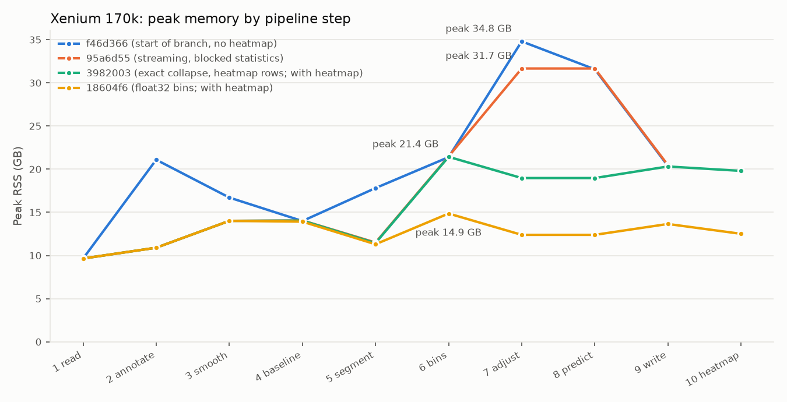

# CPU experimental branch (`cpu-experimental`), October 2026

Measured on 2026-10-11 on the development workstation: AMD Ryzen 9 5950X (16 cores / 32 threads), 125 GB RAM,
Python 3.11, NumPy 2.4.6, SciPy 1.17.1, scikit-learn 1.9.1, numba 0.68 (TBB), OpenBLAS 0.3.31, fastcluster 1.3.0.
"main" is this fork's `main` at `f0a8938`. The branch tip measured here is `90e8885`.

This branch replaces the previous "CPU experimental" stack in [`benchmarks.md`](benchmarks.md) (`perf/exact-shortcuts`
at `ff63f19`). Every commit on it says in its first line whether it changes numbers: `[NUMERICAL CHANGE]` or
`[OUTPUT CHANGE: ...]`; commits without a tag keep every output bit-identical and were checked to do so.

## Headline

Xenium 170,057 cells (132,027 called), 32 threads, heatmap drawn, large text tables written:

| | main `f0a8938` | cpu-experimental `90e8885` |
|---|---:|---:|
| Elapsed | not completed (see below) | 311 s |
| Peak RSS (process tree) | | 14.9 GB |

Main's 170k run was stopped by a scheduling error of mine after 2 h 0 min, 54 minutes into step 7: its step 4 alone
took 1 h 04 min (`pca128+fastcluster.linkage_vector`). A rerun is queued after the accuracy pass below.

For scale: in [`benchmark-cpu.md`](benchmark-cpu.md), upstream main stopped at the 97 GB memory guard at 120,000
cells, and the GPU backend peaked at 22 GB of host RSS at 170k.

Peak RSS per pipeline step on Xenium 170k (sampled every 20 ms by `run_mem_profile.py`, input loading excluded):
at the start of the branch the pipeline peaked at 34.8 GB without drawing the heatmap; drawing it added about three
float64 copies of the bins x cells matrix (+24 GB at 80,000 cells, which is what pushed main past 150 GB at 170k).
The last profile peaks at 14.9 GB with the heatmap.

## Scaling

`benchmarks/run.sh xenium<N> --plot --null-outputs` (the repository harness; heatmap drawn, the two large text tables
sent to `/dev/null`), one run at a time on an otherwise idle machine. Peak RSS is the harness's process-tree RSS and
includes reading the full 170k-cell Xenium matrix before subsetting it, which sets a floor of about 7.7 GB.

| Input cells | main, 32 threads | tip, 32 threads | tip, 8 cores pinned to CPUs 0-7 |
|---:|---|---|---|
| 10,000 | 47.9 s, 7.7 GB | 25.9 s, 7.7 GB | 25.7 s, 7.7 GB |
| 30,000 | 71.5 s, 13.3 GB | 50.2 s, 7.7 GB | 52.2 s, 7.7 GB |
| 80,000 | 2,328 s, 32.6 GB | 124.9 s, 7.9 GB | 135.7 s, 7.7 GB |
| 170,057 | stopped after 2 h (see above) | 310.8 s, 14.9 GB | 354.6 s, 13.6 GB |

The heatmap step alone: main 26.7 / 12.5 / 31.3 s at 10k / 30k / 80k, the tip 1.9-3.6 s at every size.

**The calls in this table are not all comparable.** At 30k, 80k and 170k the tip's 8-core and 32-thread runs split
the cells differently (170k: 49,695 vs 85,025 aneuploid cells). The step-4 PCA used as many OpenBLAS threads as
the process had CPUs, and OpenBLAS's results depend on the thread count; main behaves the same way. Fixed in
`fd6aa9a` (after these runs): the PCA now always uses 8 BLAS threads, and Xenium 30k gives identical calls, CNA
values and trees pinned to 8 cores and on all 32 threads. These Xenium subsets have no labels, so which split is
better is not known; they are evidently close to a tie.

At 80k the tip and main also differ at the same thread count (37,691 vs 32,514 aneuploid cells): that is
`614a691` (exact clustering of the 140-wide collapsed matrix instead of its PCA projection), which moves 5,497 of
80,000 calls on its own. **Its commit message wrongly says Xenium 80k is unchanged**; that check had been run on a
rejected variant. The commits after `90e8885` (`f567249`, `5615bd6`, `fd6aa9a`) are not in these timings.

## What changed, and what it preserves

Timings in this table are from development runs, often with another benchmark running at the same time; they show
the size of each effect, not stable estimates. "Identical" means byte-identical outputs or bit-identical arrays
in the stated comparison.

| Commit | Change | Outputs | Measured effect |
|---|---|---|---|
| `c81162f` | Per-cell GMM fallback fitted by a numba kernel, cells in parallel | identical (reproduces NumPy's summation order) | Biermann2022_Skin_MPM10_sn 1,598 s -> 54 s; Obradovic2021 210 s -> 15 s |
| `d8db11a` | Per-cluster median profiles in threads | identical | Raghavan2021 106 s -> 89 s |
| `f46d366` | Parallel reciprocal-nearest-neighbour Ward above the distance-matrix budget (port of the GPU engine) | same merge tree; heights within 8.2e-16 | Yost2019 (51k cells) 1,551 s -> 341 s |
| `f453330` | Baseline-adjustment statistics over row blocks | identical | -4.3 GB at the step-7 peak (80k) |
| `6bdbab9` | Transform and DLM smoothing streamed over cell blocks | identical | no dense float64 count matrix (11 GB at 170k) |
| `d84a142` | Segment means over cell blocks, threaded | identical | -9.7 GB at the step-5 peak (170k) |
| `b020f82` | FP32 candidate GEMM in the Ward engine | identical | Ward 40,000 x 128: 24.6 s -> 15.6 s |
| `c1e66e0` | Remembered Ward candidates re-scored instead of rescanning | identical | Ward 80,000 x 128: 62.5 s -> 25.8 s |
| `edc5205` | **[NUMERICAL]** RNN Ward from 5,000 cells (not only above the budget) | heights differ in the last bits | 20k-30k cells: 3x faster Ward, no 3-7 GB distance matrix |
| `95a6d55`, `18604f6` | **[NUMERICAL]** Step-4 silhouette from blocked float32 GEMMs | silhouette within ~1e-9 of sklearn | 12,920 x 8,321: 22.0 s -> 6.4 s |
| `614a691` | **[NUMERICAL]** Narrow collapsed matrices (<= 2x the PCA cap) clustered exactly instead of via PCA | see accuracy below; Xenium 80k: 5,497 of 80,000 calls change (6.9%), not "identical" as its message says | -13.2 GB at the step 7/8 peak (170k); Raghavan 96 s -> 70 s |
| `59d88d7`, `3982003` | **[OUTPUT: heatmap image]** At most 4,096 evenly spaced cells drawn | heatmap PNGs only | plotting +24.2 GB -> +1.6 GB (80k) |
| `abfad86` | Freeman-Tukey transform of each block in threads | identical | 5.9 s -> 2.0 s (30k) |
| `a0a5509` | Step-4 consensus GMMs with the batched kernel | identical | |
| `be08574` | **[NUMERICAL]** Bins x cells matrix stored in float32 (statistics in float64) | float32 rounding (max 6e-8); calls identical on 4 samples | peak RSS Xenium 80k 18.5 -> 9.5 GB, Yost 15.4 -> 7.9 GB |
| `d2375df` | Ward engine on physical cores only | identical | 64,000 x 128: 17.2 s -> 14.2 s |
| `90e8885` | Sparse input kept column-major | identical | -1.3 s and one copy at 170k |
| `f567249` | Bin medians by gene-count group over cell blocks | identical | Xenium 30k step 6: 2.0 s -> 0.9 s |
| `5615bd6` | Cell-line relative expression built in place | identical | two fewer full copies in cell-line mode |
| `fd6aa9a` | **[NUMERICAL]** Clustering PCA on a fixed 8 BLAS threads | PCA rounding, so trees and possibly calls, wherever OpenBLAS used another count | same results on any core count / pinning; PCA 14.6 s -> 8.4 s (64k cells) |

Also on the branch: `ca3e70f` fixes `benchmarks/benchmark.py` for the split pipeline (it crashed before step 1).

Rejected along the way: PCA on the collapsed matrix instead of the full one (changed 31% of the calls on the
low-confidence Yost2019 sample, while exact clustering changed 0.14%); a division-free scan in the Ward kernel
(within noise); capping PCA's BLAS threads (a few seconds, but it changes PCA rounding for every large sample).

## Accuracy of the numerical changes

The labelled cases of the [accuracy study](accuracy-results.md) with more than 2,000 cells (73 of 77 staged; 3 groups
failed the harness's own input checks), scored against the author labels. The base is `b1e7943`, whose outputs are
identical to main for these sizes (all below the distance-matrix budget).

`614a691` alone (exact clustering of narrow collapsed matrices): 66 of 73 cases unchanged; mean balanced accuracy
0.7666 -> 0.7667 over the cases with both classes labelled (2 better, 1 worse: +0.0068, +0.0003, -0.0002). On the four
Tabula Sapiens normal tissues that changed, false-positive aneuploid calls fell every time (TS_Tongue_TSP27:
8,519 -> 8,136 of 14,353 cells).

The whole branch at `90e8885` (all numerical changes together) against the same base: the same 7 cases change, by
the same amounts, so the other numerical changes (float32 bins matrix, silhouette, RNN heights) changed no further
calls on these samples. Over all 73 cases, the summed run time fell from 3,451 s to 1,430 s (2.4x, 32 threads, one
case at a time) and the largest per-case peak RSS from 5.0 GB to 3.8 GB.

| Case | Calls changed | Balanced accuracy, base -> branch |
|---|---:|---|
| TS_Tongue_TSP27 (normal tissue) | 14.90% | - (false positives 8,519 -> 8,136) |
| scpca SCPCL000142 | 1.71% | 0.9716 -> 0.9784 |
| Wang2019_Brain_SF10022 | 1.00% | 0.9046 -> 0.9049 |
| TS_Bone_Marrow_TSP14 (normal tissue) | 0.47% | - (false positives 6,130 -> 6,096) |
| TS_Tongue_TSP25 (normal tissue) | 0.28% | - (false positives 4,359 -> 4,349) |
| scpca SCPCL000127 | 0.14% | 0.9790 -> 0.9788 |
| TS_Stomach_TSP25 (normal tissue) | 0.01% | - (false positives 4,326 -> 4,325) |

## Reproducing

Scripts are in the maintainer's `~/cancer_research/bench` (not part of this repository): `stage_xenium.py` stages
the harness's nested Xenium subsets, `run_mem_profile.py` (with `PLOT=1`) gives the per-step memory profile,
`run_capture.py` and `diff_runs.py` compare two trees' calls, CNA values and trees, `stage_accuracy_cases.py`,
`accuracy_queue_pair.sh` and `summarize_accuracy.py` run the accuracy comparison, and
`campaign_cpu_experimental.sh` drives `benchmarks/run.sh` for the scaling table.
