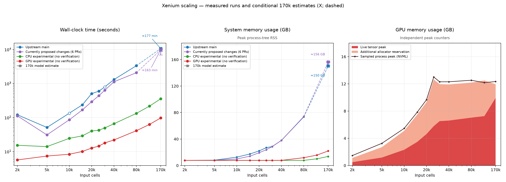

# Performance benchmarks

Wall-clock time and memory for the CopyKAT-Python pipeline on a 170k-cell Xenium
breast cancer dataset, subsampled to 2k–170k cells. This is the entry point to
the benchmark reports; for how to run the harness yourself see
[`benchmarks/README.md`](../benchmarks/README.md).



X markers and dashed lines are extrapolated 170k points, not completed runs.
Error bars show model sensitivity, not confidence intervals. Hollow markers
are runs that were not pinned to physical cores.

> **Update 2026-10-11:** the figure and the "CPU experimental" column below now show the `cpu-experimental` branch
> at `90e8885` (8 cores pinned, no heatmap), replacing the earlier `perf/exact-shortcuts` stack: 170k cells complete in
> 355 s at a 13.7 GB peak. With the heatmap on 32 threads it runs 170k in 311 s at 14.9 GB, and 80k in 125 s (fork
> main: 2,328 s, 32.6 GB). Its accuracy against main on the labelled samples and what each change preserves are in
> [`benchmark-cpu-experimental.md`](benchmark-cpu-experimental.md). Several of its commits change numbers, so its
> outputs are not identical to main's. The other columns are the earlier measurements of their own snapshots.

## What is compared

| Implementation | Meaning |
|---|---|
| Upstream main | The original implementation at commit `ea1a15c` |
| Currently proposed changes (6 PRs) | Upstream main plus the six performance PRs `#4`–`#9` proposed upstream |
| CPU experimental (no verification) | The `cpu-experimental` branch at `90e8885`: parallel and streaming CPU stages, float32 bins matrix, reciprocal-nearest-neighbour Ward, exact clustering of narrow collapsed matrices. Several commits change numbers |
| GPU experimental (no verification) | The optional CUDA backend with default Monte Carlo KS |

"No verification" means outputs were not checked to be identical to upstream;
the experimental stacks change numerical details. See
[`benchmark-scaling.md`](benchmark-scaling.md) for what each stack preserves.

## Headline numbers

Single cold runs, eight requested cores, elapsed seconds (from
[`benchmark-cpu.md`](benchmark-cpu.md)):

| Input cells | Upstream main | Proposed (6 PRs) | CPU experimental | GPU experimental |
|---:|---:|---:|---:|---:|
| 10,000 | 134 | 86 | 24 | 8 |
| 40,000 | 1,310 | 1,127 | 66 | 22 |
| 80,000 | 3,337 | 2,081 | 133 | 41 |
| 170,057 | not completed (memory guard at 120k) | not completed | 355 | 97 |

Upstream main and the six-PR stack hit the memory guard (about 97 GB of
process-tree RSS) at 120,000 cells, so their 170k points in the figure are model
estimates, not measurements. Peak process-tree RSS at 80k cells was about 74 GB
for both, versus 7.8 GB for the CPU experimental stack (the harness floor, set by reading the input) and 12 GB for the GPU
stack; the CPU stack's 170k run peaked at 13.7 GB. These are one-off measurements on one machine, not a stable estimate of
isolated per-change effects.

## Reports

| Report | Contents |
|---|---|
| [CPU experimental branch](benchmark-cpu-experimental.md) | 10k-170k scaling of `cpu-experimental` vs fork main, per-step memory, per-commit effects, accuracy on 73 labelled samples |
| [CPU-accounted scaling](benchmark-cpu.md) | Full 2k–170k sweep with CPU time, peak RSS, GPU memory, projections to 170k |
| [Serial repeats](benchmark-serial.md) | Two repeats per size from 2k to 40k, run one at a time, with output-consistency checks |
| [10k / 30k / 170k scaling and output checks](benchmark-scaling.md) | Earlier cursory sweep, kidney and mouse output comparisons, which PRs look promising |
| [Six-PR follow-up](benchmark-six-pr-followup.md) | Corrected six-PR performance and GPU-memory follow-up |
| [Accuracy study](accuracy-results.md) | Main vs. GPU + marker anchoring on 125 labelled samples (accuracy only, no timings) |

Background and method: [proposal](benchmark-proposal.md),
[expanded sweep plan](benchmark-expanded-plan.md),
[fork integration audit](fork-integration-audit.md) and the machine-readable
[manifest](benchmark-manifest.json).

## Reproducing

```bash
benchmarks/run.sh check                 # which inputs are present
benchmarks/run.sh xenium10000           # benchmark the committed HEAD at 10k cells
```

The published numbers come from the scheduling scripts in
`benchmarks/campaign/` and the report generators in `benchmarks/reports/`; they
were measured on one specific machine and have not been rerun since the
scripts were reorganised.
